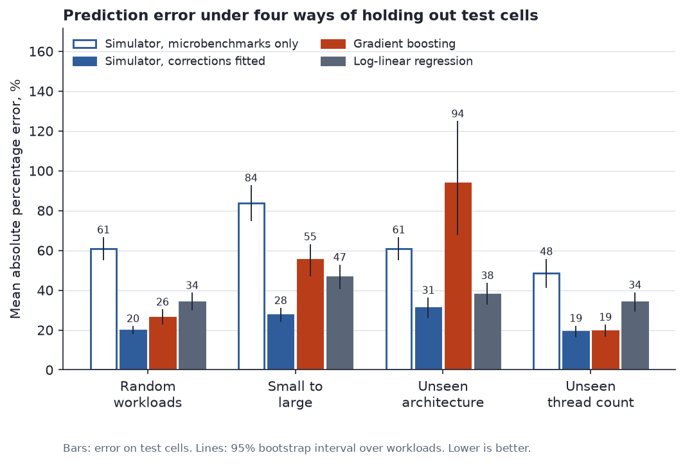

# Tensor-Workload_runtime-simulator

**Can you predict how long a neural network will take on a machine without running it
there, and when should you believe the prediction?**

This repository holds a trace-driven simulator and a study of it. The simulator turns a
PyTorch model into a list of operators, prices each one against a small description of a
device (cores, cache, memory bandwidth, a rate per operator class) and adds up the time.
The study measures 96 workloads on a real CPU and asks whether that mechanistic model
predicts workloads unlike the ones it was fitted on better than a black-box regressor
does. It was planned in [PLAN.md](PLAN.md) before anything was measured.

## What was found

Four model families (MLP, residual CNN, transformer, MLP-Mixer), 24 sizes each, timed as
forward passes and training steps on six configurations of one CPU: 1,152 cells. The
study was run twice. The first run was spoiled by other jobs on the machine. The numbers
below are from the second run, analysed on all cells as planned. It is a replication made
after I had seen the first results, not a blind test. The full write-up is in
[REPORT.md](REPORT.md).

Mean absolute percentage error of predicted against measured time:

| Test cells are... | Simulator, microbenchmarks only | Simulator, corrections fitted | Gradient boosting | Log-linear regression | FLOPs-proportional |
|---|---|---|---|---|---|
| random workloads | 21.2% | 17.8% | 23.6% | 33.7% | 62.2% |
| larger than any training workload | 19.1% | 17.1% | 50.2% | 48.2% | 196.5% |
| an architecture family never fitted on | 21.2% | 18.0% | 92.3% | 37.7% | 62.1% |
| a thread count never fitted on | 22.0% | 17.6% | 14.9% | 35.0% | 39.3% |



- **The simulator's error did not grow under extrapolation.** Calibrated only on
  single-operator microbenchmarks, it was at about 20% whether the test workloads were
  like the training ones, up to 587 times larger, or from an unseen architecture.
- **The black-box regressors matched it at interpolation and fell apart outside it.**
  Gradient boosting went from 23.6% on random workloads to 50.2% on larger ones and 92.3%
  on an unseen family. Log-linear regression, which can extrapolate a power law, did no
  better on size (48.2%).
- **Gradient boosting was better on an unseen thread count** (14.9% against 22.0%). The
  unseen count was four threads on two cores, that is, hyperthreading.
- **No predictor could choose a thread count reliably.** The simulator's choice was
  within 10% of the best in 65.6% of 192 cases. I had predicted 90%.
- **A descriptor carries the state of the machine it was calibrated on.** In the first
  run the calibration was taken on a slowed machine and the simulator over-predicted by a
  factor of 1.51. In the second it was taken at the machine's fastest and the simulator
  under-predicted, with predictions 0.81 times the measured time.
- Three of the seven hypotheses in the plan held in the second run and two failed in ways
  that count against the simulator. In the first run one held. The report gives each.

**How far to trust the numbers.** Even with nothing else heavy running, the laptop's
clock frequency moved between 1,150 and 3,773 MHz during the second run, and a fixed
reference benchmark was up to 2.49 times slower at its worst than at its best. A repeat
pass over 230 cells disagreed with the first pass by 30.5% on average. I had said I would
not correct for drift a second time, and I have not. Differences of a few points between
predictors mean nothing here. The gaps under extrapolation are 30 points and more.

This is one laptop CPU, pinned to two cores. Nothing was measured on a GPU or any other
accelerator.

## What is in the repository

Written from scratch around PyTorch, NumPy, SciPy and scikit-learn.

| Part | File | What it does |
|---|---|---|
| Workloads | `src/tracesim/zoo.py` | Four model families built from primitive operators, and the grid of 96 workloads |
| Trace capture | `src/tracesim/trace.py` | Turns a module and an input into an operator trace with `torch.fx`: classes, shapes, FLOPs, bytes |
| Device descriptor | `src/tracesim/device.py` | The JSON description of a device, and edited copies for what-if questions |
| Executor | `src/tracesim/simulator.py` | Prices each operator and replays the trace as a discrete-event simulation |
| Microbenchmarks | `src/tracesim/microbench.py` | Times single operators across sizes, dtypes and thread counts |
| Calibration | `src/tracesim/calibrate.py` | Fits a descriptor to microbenchmark points, or to a restricted set of them |
| Timing | `src/tracesim/timing.py`, `quiet.py`, `reference.py` | Median-of-repeats timer, CPU pinning, a guard against interference, a reference benchmark for drift |
| Measurement | `src/tracesim/measure.py` | Resumable runner that times every workload on every configuration |
| Baselines | `src/tracesim/baselines.py` | FLOPs-proportional, gradient boosting, log-linear regression, fitted simulator corrections |
| Test designs | `src/tracesim/evaluate.py` | The four hold-out designs; writes one row per prediction |
| Statistics | `src/tracesim/stats.py` | MAPE, rank correlation, decision regret, bootstrap intervals over workloads |
| Projections | `src/tracesim/whatif.py` | Replays traces against devices that were not measured |
| Figures | `src/tracesim/figures.py` | Every figure in this README and the report |
| The measured device | `devices/host.json` | The fitted descriptor of the machine used here |
| The first run | `results/run1/`, `docs/img/run1/` | Result files, descriptor and figures of the spoiled first run |

## Try it

You need Python 3.11 or newer and [uv](https://docs.astral.sh/uv/). No GPU is used.

```bash
git clone https://github.com/AmosBunde/Tensor-Workload_runtime-simulator
cd Tensor-Workload_runtime-simulator
uv sync --extra dev          # installs CPU PyTorch, SciPy, scikit-learn
uv run pytest -q             # 46 tests, a few seconds
```

Predict one workload on the committed descriptor, without timing anything:

```bash
uv run tracesim capture --workload transformer-d256-d2-s128-b8
uv run tracesim predict --workload transformer-d256-d2-s128-b8 --mode train --threads 2
```

The first prints the operator trace. The second prints a predicted time, its split into
compute, memory, call overhead and threading loss, and the time by operator class.
`uv run tracesim capture --list` gives the 96 workload ids.

## Reproduce the study

The result files from my second run are committed, so steps 5 to 7 work straight after
cloning. Steps 1 and 3 time real code and need a quiet Linux machine with at least two
physical cores; they pin themselves to two of them. Times are from my second run.

| Step | Command | Time | Writes |
|---|---|---|---|
| 1. Time single operators | `uv run tracesim microbench` | about 4 min | `results/microbench.jsonl`, `results/reference.jsonl` |
| 2. Fit the device descriptor | `uv run tracesim calibrate` | seconds | `devices/host.json`, `results/calibration.json` |
| 3. Time every workload | `uv run tracesim measure` | about 30 min | `results/measurements.jsonl`, `results/reference.jsonl` |
| 4. Recheck the calibration | `uv run tracesim microbench --recheck` | 15 s | `results/microbench_recheck.jsonl` |
| 5. Run the four test designs | `uv run tracesim evaluate` | about 1 min | `results/predictions.csv` |
| 6. Project unmeasured devices | `uv run tracesim whatif` | 10 s | `results/whatif.json` |
| 7. Statistics and figures | `uv run tracesim summarise && uv run tracesim figures` | 20 s | `results/summary.json`, `docs/img/` |

Steps 1 and 3 skip anything already in their output file, so they can be stopped and
restarted; delete the files, including `results/reference.jsonl`, to start again. Step 5
captures 384 traces on first use and caches them in `data/` (9 MB, not in git).

Timings will not match mine. They depend on the machine and on its state from minute to
minute. Before trusting a new set of measurements, read `reference` and `drift` in
`results/summary.json`: they say how much the machine's speed moved during the run.

The first run can be re-analysed from its own files:

```bash
uv run tracesim evaluate --measurements results/run1/measurements.jsonl \
    --points results/run1/microbench.jsonl --device results/run1/host.json \
    --out results/run1/predictions.csv --clean-cutoff-minutes 10
```

## Reading the results yourself

- `results/summary.json`: every second-run number quoted here and in the report, under
  `planned`. `reference` and `drift` describe the machine's speed during the run.
- `results/predictions.csv`: one row per test cell and design, with the measured time and
  each predictor's prediction.
- `results/measurements.jsonl`: one row per timing, with quartiles, the number of
  attempts and how busy other processes kept the pinned CPUs.
- `results/reference.jsonl`: the reference benchmark and CPU frequency every two minutes.
- `results/microbench.jsonl`: the 966 operator timings the descriptor was fitted to.
- `results/run1/`: the same files for the first run. Its `summary.json` also has a
  `clean` block, an analysis of the 495 cells measured before that machine slowed down.

## Limits

- **CPU only.** One Intel i7-10610U, pinned to two cores. The descriptor format (rates
  per operator class, memory bandwidth, a serial fraction) was designed with accelerators
  in mind but has not been tested on one, and I claim nothing about GPUs or TPUs.
- **The machine's speed was not constant.** Timings use warm-up, repeats and medians, and
  each cell was repeated when other processes were on its CPUs. None of that addresses a
  processor that changes its own clock frequency. The noise within the main pass of the
  second run is not known; the only estimate, 30.5% between passes, is inflated by the
  second pass running slower.
- **The primary result is a replication, not a blind test.** I ran the study again after
  seeing it fail, and corrected a defect in the analysis code after seeing the second
  run. The plan lists both.
- **Calibration state.** The simulator's absolute level depends on how fast the machine
  was when the microbenchmarks ran. Its bias had opposite signs in the two runs.
- **Small numbers.** 96 workloads; 48 in the size test; four families, so the
  unseen-architecture test has four folds.
- **The projections for unmeasured devices are not validated.** They also changed
  severalfold between the two calibrations.
- The plan was written first but was not registered anywhere, and I also ran the study.

## Licence

MIT. See [LICENSE](LICENSE).
