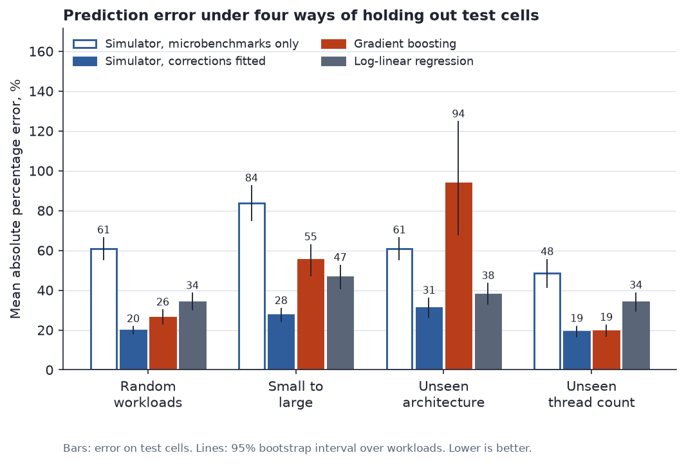
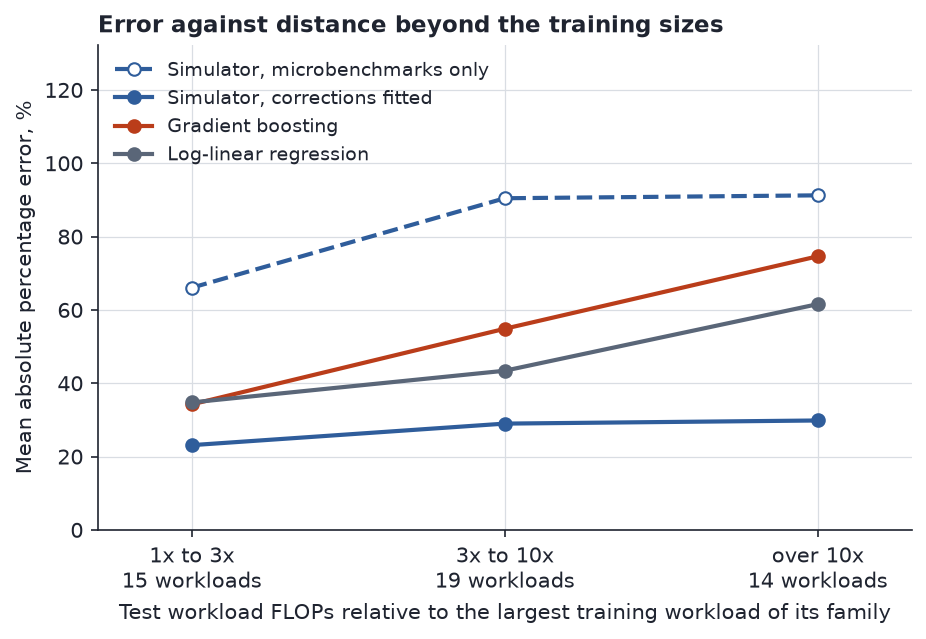
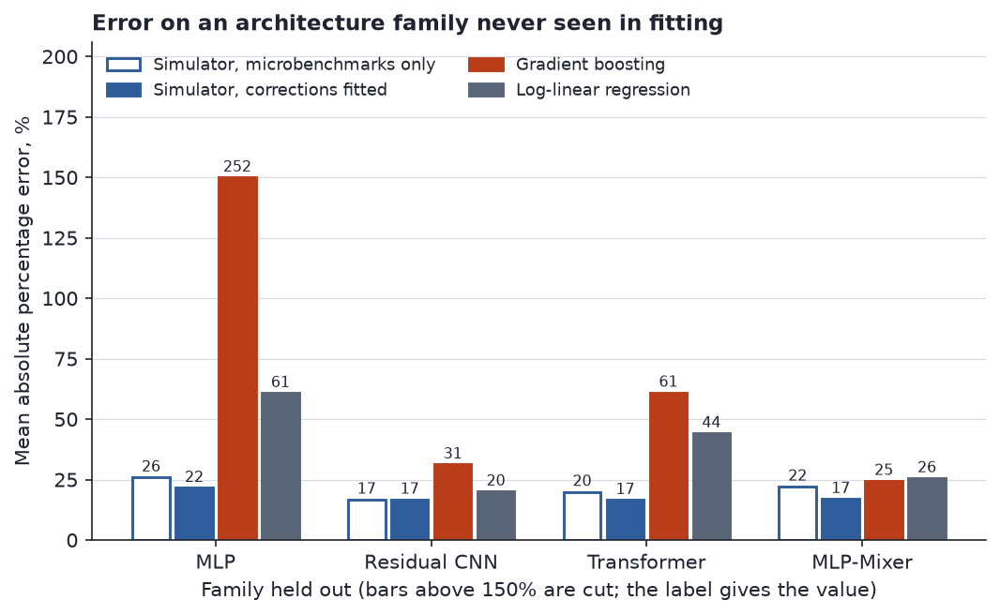

# When can a simulated runtime be trusted? A mechanistic and a black-box predictor under extrapolation

Amos Bunde, November 2026

## Summary

I built a simulator that predicts how long a tensor workload takes on a described device.
It captures a PyTorch model as a trace of operators, prices each operator from a small
device descriptor, and replays the trace. I then measured 96 workloads from four
architecture families on six configurations of one CPU and compared the simulator with
black-box regressors under four test designs: random held-out workloads, workloads larger
than any in training, an unseen architecture family and an unseen thread count.

The machine was shared and slowed down for most of the measurement run. On the 495 cells
measured at full speed, where a repeat of the same cell differs by 15% on average:

- The simulator calibrated from operator microbenchmarks alone had 60.8% error on random
  workloads and 83.8% from small to large. Gradient boosting had 26.2% and 55.3%. The
  calibration had been taken on a machine running 1.41 times slower than normal, and the
  simulator over-predicted by about that much.
- The same simulator with one fitted correction per operator class had 19.9% and 27.6%.
  It was the most accurate predictor under every design. From random to larger workloads
  its error rose by 7.7 points; gradient boosting's rose by 29.1.
- Gradient boosting failed on an unseen architecture (93.7%), as trees must when the
  target leaves the range they were fitted on.

Six of my seven hypotheses were about the uncorrected simulator and were not supported.
The result I did not plan for is the useful one: the structure of the mechanistic model
extrapolates, and its absolute calibration does not survive a change in machine state.

The study is small and noisy: one laptop CPU, two pinned cores, no accelerator, and an
analysis subset chosen after the fact.

## 1. Question

Suppose a model has to run on a machine that is not available yet: one that is on order,
or one that exists only as a design. How long will a forward pass or a training step take
there? Two kinds of answer are on offer.

A **black-box** answer measures many workloads on machines one does have, fits a regressor
from workload features to time, and asks the regressor. A **mechanistic** answer writes
down what the machine does with an operator (so much arithmetic at such a rate, so many
bytes at such a bandwidth) and adds it up.

The black box is usually more accurate on workloads like the ones it was fitted on. But
the interesting predictions are the ones outside that set: a larger model, a new
architecture, a different machine configuration. The question of this study is which kind
of predictor can be trusted there, and by how much.

## 2. Method

### 2.1 Traces

A PyTorch module is traced symbolically with `torch.fx` [1] and run once through an
interpreter that records every call: its operator class, tensor shapes, dtype, parameter
count, FLOPs and bytes read and written. The trace has no timing in it and nothing about
any device.

Two details mattered. A `reshape` of a non-contiguous tensor silently copies it, which
attention does once per layer; the tracer notices from the storage pointers and records a
copy. And a training step is recorded by tracing the model together with its loss with
gradients switched on, so each operator knows whether a backward pass will visit it and
whether gradient has to flow on to its input. One SGD update per parameter tensor is
appended.

Operators fall into 17 classes: matrix products (`gemm`), batched matrix products
(`bmm`), four kinds of convolution, two kinds of element-wise operation, layer
normalisation, batch normalisation in each mode, softmax, pooling, embedding lookup,
reduction, copy, and `free` for views that only cost a call.

### 2.2 The device descriptor

The descriptor is a JSON file of under 300 lines ([devices/host.json](devices/host.json)).
It has the number of cores and hardware threads per core, the last-level cache size, the
memory bandwidth on one thread and how it scales, a first-touch rate for freshly mapped
pages, and for each operator class:

- a rate, in FLOPs or elements per second on one thread, for float32 and for float64;
- a fixed overhead per call;
- a serial fraction, which sets how the class speeds up with cores in the manner of
  Amdahl's law [2], and a fork cost paid when more than one thread is used;
- a hyperthread yield: what a second hardware thread on a busy core adds;
- the cost of the backward pass relative to the forward pass.

### 2.3 Pricing an operator and replaying a trace

A call costs its overhead plus the larger of a compute time and a memory time:

```
compute = work / rate, shortened by threads according to the serial fraction
memory  = (share of the working set that does not fit in cache) x bytes / bandwidth
time    = overhead + max(compute, memory) + first-touch cost of a large output
```

Taking the larger of the two is the roofline idea [3]: a call is limited either by
arithmetic or by how fast memory can feed it. In a training step, each operator the
backward pass visits is charged again at the class's measured backward ratio.

The executor replays the trace as a discrete-event simulation over the operator
dependency graph. With one stream of execution, which is how PyTorch runs a model on a
CPU, that is a sequential replay. The output is a time per operator, a total, and the
total split into compute, memory, call overhead and threading loss.

### 2.4 Calibration

The descriptor is fitted to microbenchmarks of single operators: 161 cases, each
on float32 and float64 and on 1, 2 and 4 threads, 966 timings in all. Each case
is traced by the same code that traces models, so work and bytes are counted identically
in calibration and in prediction. The fit minimises squared log error with a robust loss.
The descriptor never sees a whole workload.

The fitted descriptor reproduces its own calibration points with a mean error between
11% (batch normalisation in training mode) and 52% (1x1 convolutions), depending on the
class. That is a floor on what it can predict. 260 of the 966 points were taken with other
processes busy on the pinned CPUs despite up to four attempts.

### 2.5 Workloads, device configurations and timing

Four families, each written from primitive operators so the trace is complete: an MLP, a
residual CNN [7], a pre-norm transformer encoder [8] and an MLP-Mixer [9]. Each has 24
workloads varying width, depth, batch size and sequence length or image size. Forward
FLOPs span 75 thousand to 39 billion, and measured times 70 microseconds to 5.5 seconds.
Each workload is timed as a forward pass and as a training step with SGD.

The hardware is one Intel i7-10610U laptop CPU with no GPU. A device configuration is a
thread count (1, 2 or 4) and a dtype (float32 or float64). The plan assumed four free
cores. In practice other jobs kept the machine busy, and an unpinned four-thread operator
could wait milliseconds for four cores to be free at once. Before measuring any workload
I pinned the process to both hardware threads of two physical cores. So 4 threads here
means two cores with hyperthreading. This and four other changes made before the
validation run are listed in the plan.

A cell is one workload, one mode and one configuration: 96 x 2 x 6 = 1,152 cells. Each
is timed after warm-up for at least five repeats (three for the slowest cells)
and summarised by the median. Cells are visited in random order. A guard reads from
`/proc/stat` how busy other processes kept the pinned CPUs during a cell and repeats the
cell, up to three attempts, if that exceeds 0.4 CPUs. A second pass re-measures a random
230 cells.

### 2.6 Predictors

- **Simulator.** Calibrated from microbenchmarks only.
- **Simulator with fitted corrections.** One multiplicative correction for each of the 17
  operator classes, fitted by non-negative least squares on the training cells and pulled
  towards 1.
- **FLOPs-proportional.** One constant per configuration and mode.
- **Gradient boosting** [5, 6]. 400 trees of depth 3 on the log of 24 trace totals plus
  threads, dtype and mode, predicting log time. Hyperparameters were fixed in advance.
- **Log-linear regression.** Ridge regression of log time on the logs of five whole-trace
  totals with interactions. It can extrapolate a power law, which trees cannot, so it is
  the fairer black-box opponent when the test is extrapolation.

### 2.7 Test designs

| Design | Fitted on | Tested on | What the simulator may be calibrated on |
|---|---|---|---|
| Random | 4/5 of workloads | the other 1/5, five folds | all microbenchmarks |
| Size | the smaller half of each family by FLOPs | the larger half | per class, only operators no larger than the largest in the training half |
| Family | three families | the fourth, four folds | all microbenchmarks |
| Threads | cells with 1 and 2 threads | cells with 4 threads | 1- and 2-thread microbenchmarks only |

All cells of a workload stay on the same side of a split. In the size design the test
workloads are 1.02 to 587 times the FLOPs of the largest training workload of their
family. In the thread design the simulator cannot know what a hyperthread adds, so it
assumes nothing: it predicts that 4 threads are no faster than 2.

### 2.8 Metrics

Mean absolute percentage error (MAPE) of predicted against measured time is primary. I
also report Spearman rank correlation, and a decision measure: for each workload and
mode, the predictor picks the thread count it expects to be fastest at float32, and the
regret is how much slower that choice was than the best. Intervals are 95% bootstrap
intervals that resample workloads, because the cells of one workload are not independent.

## 3. What happened to the measurements

The second pass was meant to give a noise floor. It gave more than that.


For the first twelve minutes the two passes agree: the median ratio of first-pass to
second-pass time is between 0.93 and 1.04. From then until the end of the first pass the
machine was 1.12 to 2.67 times slower. Over all 230 repeated cells the two measurements
differ by 27.9% on average. That is as large as the errors of the best predictors, so the
planned analysis cannot tell them apart.

The guard did not catch this. It flagged 314 of the 1,152 cells as busy, but it can only
see other processes taking the pinned CPUs, and this slowdown was wider than that. I did
not record CPU frequency or temperature and cannot say whether it was thermal throttling,
shared cache and memory, or something else.

I ran every analysis twice. The **planned** analysis uses all 1,152 cells. The **clean**
analysis uses the 495 cells measured in the first ten minutes of the first pass or in the
second pass; a cell measured in both takes its second-pass time. Because cells were
visited in random order the 495 are a random subset. They cover all 96 workloads (181,
155 and 159 cells at 1, 2 and 4 threads). On the 71 cells measured in both clean windows
the two times differ by 15.1% on average (median 10.7%). That is the noise floor for
everything below. The ten-minute cut was chosen from the figure above, after the fact.

## 4. Results

Numbers are from the clean analysis unless marked. The planned analysis is in 4.6.

### 4.1 Overview

| Design | Test cells | Simulator | Simulator, corrections fitted | Gradient boosting | Log-linear | FLOPs |
|---|---|---|---|---|---|---|
| Random | 495 | 60.8 (55.3 to 66.3) | 19.9 (18.2 to 21.8) | 26.2 (23.2 to 30.1) | 34.1 (30.1 to 38.4) | 56.7 |
| Size | 250 | 83.8 (75.0 to 92.4) | 27.6 (24.4 to 30.8) | 55.3 (47.3 to 62.9) | 46.7 (40.7 to 52.5) | 174.3 |
| Family | 495 | 60.8 (55.3 to 66.3) | 31.2 (26.4 to 36.0) | 93.7 (67.9 to 124.6) | 37.8 (33.0 to 43.4) | 56.0 |
| Threads | 159 | 48.5 (41.5 to 55.4) | 19.2 (16.7 to 21.9) | 19.5 (16.8 to 22.5) | 34.0 (29.5 to 38.7) | 41.4 |

MAPE in percent, with 95% intervals.



### 4.2 Interpolation (H1: supported on clean data, not on planned)

On random held-out workloads gradient boosting beat the uncorrected simulator by 34.6
points (interval 27.5 to 41.0). That is what I predicted, but not for the reason I had in
mind. I expected the simulator to be roughly right and the regressor to be better. The
simulator was biased: its predictions were 1.51 times the measured time in geometric
mean.

A recheck explains most of that. After the study I re-timed 78 of the microbenchmark
cases. They had taken a median of 1.41 times longer during calibration (quartiles 1.04
and 1.84), and 81% of them were slower then. The descriptor describes a machine that was
running slow.

The simulator with fitted corrections does not depend on the absolute calibration, and
it beat gradient boosting by 6.3 points (3.6 to 9.3). Its errors were 22.6% on forward
passes and 17.2% on training steps.

### 4.3 Small to large (H2: failed)

I predicted the simulator would beat gradient boosting when the test workloads are larger
than the training ones. Uncorrected, it was worse by 28.5 points (17.8 to 39.8), and
worse than log-linear regression by 37.1.

The corrected simulator is another matter. It beat gradient boosting by 27.7 points (19.5
to 35.2).

| Test FLOPs over largest training FLOPs | Workloads | Simulator | Simulator, corrections fitted | Gradient boosting | Log-linear |
|---|---|---|---|---|---|
| 1x to 3x | 15 | 66.1 | 23.1 | 34.2 | 34.8 |
| 3x to 10x | 19 | 90.5 | 29.0 | 54.9 | 43.4 |
| over 10x | 14 | 91.3 | 29.8 | 74.6 | 61.6 |



Gradient boosting's predictions for the large workloads were 0.35 times the measured
time in geometric mean: a tree cannot predict a time longer than any it has seen. Its
rank correlation fell to 0.79, against 0.98 for the simulator. The plan said that if
log-linear regression matched the simulator here, the advantage would be one of
functional form and not of modelling the machine. It did not match the corrected
simulator (46.7 against 27.6) and it did beat the uncorrected one.


The uncorrected simulator got worse under this design than under the random one, 83.8
against 60.8. Under this design its microbenchmarks are cut off at the operator sizes
seen in training; with all microbenchmarks it scored 76.6 on the same cells. So seeing
only small operators cost it about 7 points, and the rest is the calibration bias growing
with size.

### 4.4 Unseen architecture (H3: supported on planned data, failed on clean)

| Family held out | Simulator | Simulator, corrections fitted | Gradient boosting | Log-linear |
|---|---|---|---|---|
| MLP | 57.8 | 25.6 | 240.3 | 59.3 |
| Residual CNN | 62.7 | 62.8 | 37.2 | 21.5 |
| Transformer | 62.3 | 19.8 | 76.7 | 44.4 |
| MLP-Mixer | 60.3 | 16.6 | 24.9 | 26.6 |



The uncorrected simulator beat gradient boosting on two families of four, so the
hypothesis fails on the clean data. Its error barely moves between families, around 60%,
because it never looks at the training workloads.

The corrected simulator was best on three families and worst on the fourth. When the CNN
is held out, no training workload contains a 3x3 convolution or batch normalisation, so
those corrections stay at 1 and the calibration bias comes straight through. A
mechanistic model can only be corrected for operators it has been shown. Gradient
boosting's 240% on the MLP is the largest single failure in the study.

### 4.5 Unseen thread count (H4: failed)

Fitted on 1 and 2 threads and tested on 4, the uncorrected simulator had 48.5% error
against 19.5% for gradient boosting. The corrected simulator had 19.2%, which is not
distinguishable from gradient boosting (difference 0.2 points, interval -3.8 to 3.3).

This design turned out weaker than I intended. With the process pinned to two cores, the
unseen configuration is hyperthreading, and both predictors do the same thing with it:
they predict that 4 threads behave like 2. That is a fair default and it was about right.
It is not evidence that either understands thread scaling.

### 4.6 The planned analysis

On all 1,152 cells, with a noise floor of 27.9%:

| Design | Simulator | Simulator, corrections fitted | Gradient boosting | Log-linear | FLOPs |
|---|---|---|---|---|---|
| Random | 41.0 | 28.1 | 37.9 | 42.1 | 71.7 |
| Size | 53.9 | 35.2 | 54.7 | 48.8 | 217.2 |
| Family | 41.0 | 32.0 | 101.4 | 45.4 | 71.5 |
| Threads | 32.1 | 28.2 | 31.1 | 36.3 | 43.6 |

The uncorrected simulator looks much better here than on the clean cells. I do not think
that is to its credit. Most cells in this analysis were measured while the machine was
slow, and the simulator had been calibrated while the machine was slow, so two errors
partly cancel. The corrected simulator is again the most accurate in every row, and it
sits at the noise floor in two of them.

### 4.7 Ranking and choosing a configuration (H5: failed)

Rank correlation over test cells was at least 0.98 for both forms of the simulator in
every design on the clean cells. That sounds better than it is. Times span five orders of
magnitude, and any predictor that knows a large model from a small one will score well.

The decision measure is harder. Choosing among 1, 2 and 4 threads at float32, the
simulator's choice was within 10% of the best measured time in 54.2% of 192 cases on all
cells, with a mean regret of 24.6%. I had predicted 90%. Gradient boosting managed 55.7%
and FLOPs-proportional 51.6%. On the clean cells only 16 workload-mode pairs have all
three thread counts, and the simulator was within 10% in 8 of them.

Two things limit this result. On two cores the 2- and 4-thread times are often within
the noise of each other, so "the best" is partly luck. And the 192-case figure comes from
the slowed data.

### 4.8 FLOPs and absolute accuracy (H6 and H7: failed)

FLOPs-proportional prediction was poor, 56.7% on random workloads and 174.3% from small
to large, but it was not the worst predictor in every design as I had predicted. On clean
cells the uncorrected simulator was worse in the random and thread designs, and gradient
boosting was worse on unseen families.

I predicted the uncorrected simulator would be within 30% over all cells. It was at 41.0%
on all cells and 60.8% on the clean ones.

### 4.9 Rescaling by the recheck factor (exploratory)

If the calibration was slow by a known factor, the simplest repair is to divide every
prediction by it. Using the recheck median of 1.41, which comes from operator timings and
not from any workload:

| Design | Simulator rescaled | Gradient boosting | Difference (95% interval) |
|---|---|---|---|
| Random | 26.1 | 26.2 | -0.1 (-4.1 to 3.3) |
| Size | 35.9 | 55.3 | -19.3 (-27.8 to -10.5) |
| Family | 26.1 | 93.7 | -67.6 (-98.6 to -41.2) |
| Threads | 21.4 | 19.5 | 2.0 (-1.9 to 6.2) |

With one constant and no workload data the simulator matches gradient boosting at
interpolation and beats it under both kinds of extrapolation. This is the pattern H1 to
H3 predicted. It was found after the fact, with a correction I thought of after seeing
the failure, so it is a lead and not a result. The proper test is to recalibrate on a
quiet machine and measure again.

### 4.10 Scorecard

| | Prediction | Planned analysis | Clean windows |
|---|---|---|---|
| H1 | Gradient boosting beats the simulator at interpolation | Not supported: 37.9 against 41.0, interval includes zero | Supported: 26.2 against 60.8 |
| H2 | The simulator beats gradient boosting from small to large | Not supported: 53.9 against 54.7 | Failed: 83.8 against 55.3 |
| H3 | The simulator wins on at least 3 of 4 unseen families | Supported: 3 of 4 | Failed: 2 of 4 |
| H4 | The simulator wins on an unseen thread count | Not supported: 32.1 against 31.1 | Failed: 48.5 against 19.5 |
| H5 | Thread choice within 10% of best in 90% of cases | Failed: 54.2% of 192 | Failed: 8 of 16 |
| H6 | FLOPs-proportional is worst in every design | Failed | Failed |
| H7 | Simulator MAPE below 30% over all cells | Failed: 41.0 | Failed: 60.8 |

## 5. A projection for devices I do not have

**Nothing in this section is validated.** I edited the host descriptor and replayed the
largest workload of each family against the edited copies.


| Training step, float32 | 2x memory bandwidth | 8 cores | 16 cores |
|---|---|---|---|
| MLP, width 2048 | 1.00 | 1.37 | 1.46 |
| Residual CNN, width 64 | 1.00 | 2.09 | 2.55 |
| Transformer, width 512 | 1.00 | 1.41 | 1.51 |
| MLP-Mixer, width 512 | 1.00 | 1.38 | 1.48 |

Speed-up over the measured host with two threads on two cores.

The simulator says doubling memory bandwidth would change nothing. In its accounting no
operator in these workloads is limited by memory on the host: wherever a working set exceeds the
8 MiB cache, the arithmetic still takes longer than the memory traffic. I have no
measurement that checks this. The predicted time is 68% to 83% compute for the large workloads and
the rest threading loss; for the smallest workloads call overhead is 52% to 96%.


It says more cores would help the CNN about twice over and the others by less than half.
I do not trust the second part. It follows from a fitted serial fraction of 0.47 for
matrix products, which rests on one- and two-thread microbenchmarks taken on a disturbed
machine. And the baseline these speed-ups are relative to is itself wrong: where a clean
measurement of the host exists, the simulator predicted 0.30 s against 0.21 s measured
for the CNN forward pass, 0.88 s against 0.37 s for the Mixer forward pass, and 1.49 s
against 0.55 s for the MLP training step. A projection is no better than the calibration
under it, and this calibration is known to be off.

## 6. Limits

- **One CPU, no accelerator.** Every measurement is from two pinned cores of one laptop
  processor. The descriptor format was designed so that an accelerator could be described
  the same way, but that is untested, and nothing here is a claim about GPUs or TPUs.
- **Noise.** The machine was shared. Even on the clean cells a repeat differs by 15% on
  average, and differences between predictors smaller than that should not be read as
  real. The intervals capture sampling of workloads, not measurement noise.
- **The clean analysis is post hoc.** I chose to look at a subset, and where to cut it,
  after seeing the data. The planned analysis is reported beside it for that reason.
- **Calibration state.** The descriptor was fitted while the machine was slow. I did not
  recalibrate, so the study does not show how accurate a well-calibrated simulator is.
  The interference guard cannot see a machine-wide slowdown, and I recorded neither CPU
  frequency nor temperature.
- **The corrected simulator is not a pure mechanistic model.** It has 17 fitted numbers.
  That is far fewer than 400 trees, but it has seen the training workloads.
- **Small numbers.** 96 workloads, 48 in the size test, four folds in the family test.
- **Coverage.** Four families, SGD only, batch-first dense models. Operators outside the
  17 classes are not priced. Running independent operators in parallel is implemented in
  the executor but was not validated.
- **Budget.** Timed runs took about 65 minutes against a planned 45, and two earlier
  microbenchmark runs were thrown away.
- **Prior work.** Predicting neural-network runtime from layer-level models is not new
  [10, 11], and cycle-level simulators exist for far more detailed questions [12]. I did
  not survey the literature systematically. What this adds is a small controlled
  comparison of the two kinds of predictor under explicit extrapolation, with its
  failures.

## 7. What I would do next

1. Recalibrate on a quiet machine, with a fixed reference benchmark interleaved through
   every run so that drift is measured and not inferred, and repeat the study. That tests
   the lead in 4.9.
2. Record CPU frequency with every timing and put machine state in the descriptor.
3. Fit the serial fraction from more than two thread counts, on a machine with enough
   free cores to do it.
4. Write a descriptor for an accelerator and find out which parts of the model survive.

## References

1. Reed, DeVito, He, Ussery, Ansel. torch.fx: Practical Program Capture and
   Transformation for Deep Learning in Python. MLSys 2022.
2. Amdahl. Validity of the single processor approach to achieving large scale computing
   capabilities. AFIPS Spring Joint Computer Conference, 1967.
3. Williams, Waterman, Patterson. Roofline: An Insightful Visual Performance Model for
   Multicore Architectures. Communications of the ACM, 2009.
4. Paszke et al. PyTorch: An Imperative Style, High-Performance Deep Learning Library.
   NeurIPS 2019.
5. Friedman. Greedy function approximation: A gradient boosting machine. Annals of
   Statistics, 2001.
6. Pedregosa et al. Scikit-learn: Machine Learning in Python. Journal of Machine Learning
   Research, 2011.
7. He, Zhang, Ren, Sun. Deep Residual Learning for Image Recognition. CVPR 2016.
8. Vaswani et al. Attention Is All You Need. NeurIPS 2017.
9. Tolstikhin et al. MLP-Mixer: An all-MLP Architecture for Vision. NeurIPS 2021.
10. Qi, Sparks, Talwalkar. Paleo: A Performance Model for Deep Neural Networks. ICLR 2017.
11. Yu, Gao, Golikov, Pekhimenko. Habitat: A Runtime-Based Computational Performance
    Predictor for Deep Neural Network Training. USENIX ATC 2021.
12. Binkert et al. The gem5 simulator. ACM SIGARCH Computer Architecture News, 2011.
