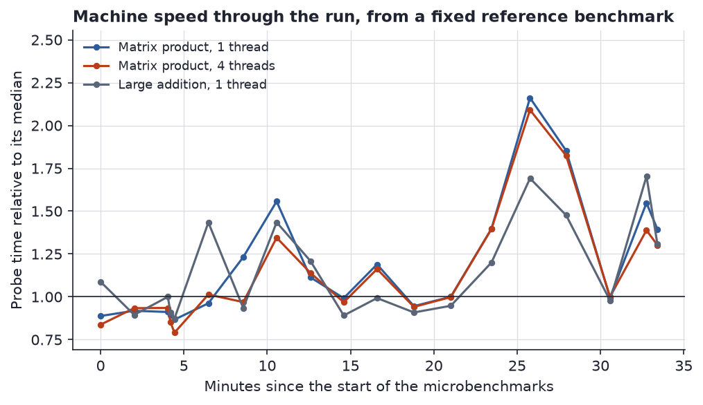
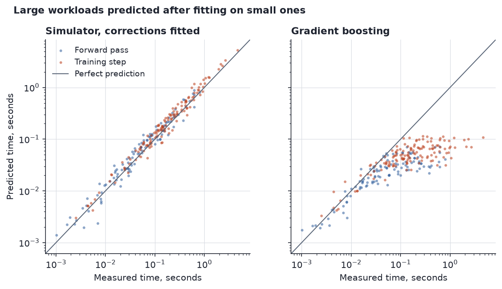
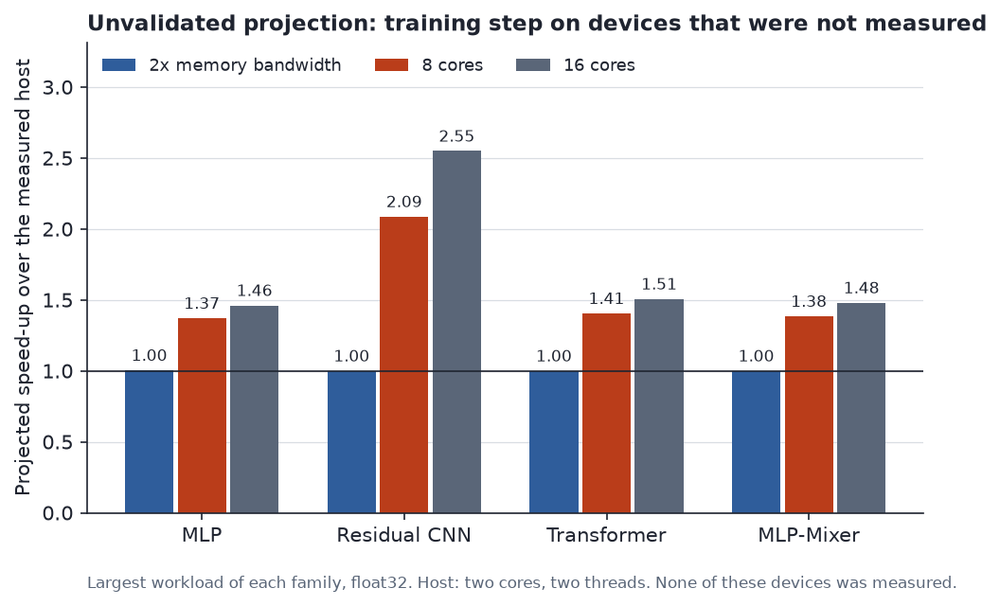
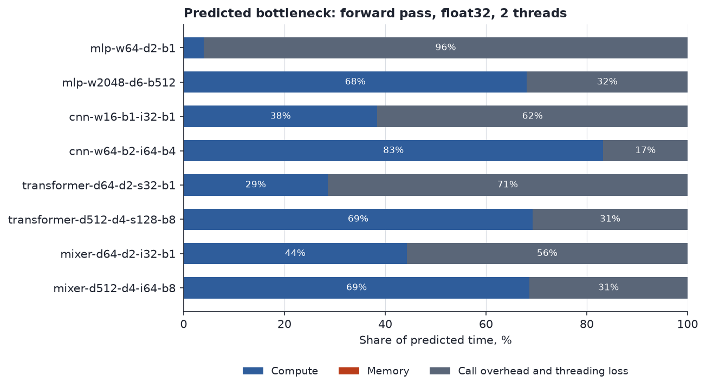

# When can a simulated runtime be trusted? A mechanistic and a black-box predictor under extrapolation

Amos Bunde, November 2026

## Summary

I built a simulator that predicts how long a tensor workload takes on a described device.
It captures a PyTorch model as a trace of operators, prices each operator from a small
device descriptor, and replays the trace. I then measured 96 workloads from four
architecture families on six configurations of one CPU and compared the simulator with
black-box regressors under four test designs: random held-out workloads, workloads larger
than any in training, an unseen architecture family and an unseen thread count.

The study was run twice. The first run was spoiled: other jobs slowed the machine during
both calibration and measurement. The second run, with nothing else heavy on the machine,
is reported here as the primary result. It is a replication made after seeing the first
results, and it is analysed on all 1,152 cells exactly as planned.

- The simulator, calibrated only on single-operator microbenchmarks, had 21.2% error on
  random workloads, 19.1% on workloads larger than any in training and 21.2% on an unseen
  architecture family.
- Gradient boosting had 23.6%, 50.2% and 92.3%. Log-linear regression had 33.7%, 48.2%
  and 37.7%.
- On an unseen thread count gradient boosting was better: 14.9% against 22.0%.
- The simulator's choice of thread count was within 10% of the best in 65.6% of cases. I
  had predicted 90%.

Three of seven hypotheses held, among them the one the study was built around: the
mechanistic model extrapolates in size where the black box does not. Two failed against
the simulator.

The measurements are noisier than I wanted. The laptop's clock frequency moved between
1,150 and 3,773 MHz during the second run, and a repeat pass disagreed with the first
pass by 30.5% on average. Differences of a few points between predictors should not be
read as real. The differences under extrapolation are 30 points and more.

## 1. Question

Suppose a model has to run on a machine that is not available yet: one that is on order,
or one that exists only as a design. How long will a forward pass or a training step take
there? Two kinds of answer are on offer.

A **black-box** answer measures many workloads on machines one does have, fits a regressor
from workload features to time, and asks the regressor. A **mechanistic** answer writes
down what the machine does with an operator (so much arithmetic at such a rate, so many
bytes at such a bandwidth) and adds it up.

The black box is usually more accurate on workloads like the ones it was fitted on. But
the interesting predictions are the ones outside that set: a larger model, a new
architecture, a different machine configuration. The question of this study is which kind
of predictor can be trusted there, and by how much.

## 2. Method

### 2.1 Traces

A PyTorch [4] module is traced symbolically with `torch.fx` [1] and run once through an
interpreter that records every call: its operator class, tensor shapes, dtype, parameter
count, FLOPs and bytes read and written. The trace has no timing in it and nothing about
any device.

Two details mattered. A `reshape` of a non-contiguous tensor silently copies it, which
attention does once per layer; the tracer notices from the storage pointers and records a
copy. And a training step is recorded by tracing the model together with its loss with
gradients switched on, so each operator knows whether a backward pass will visit it and
whether gradient has to flow on to its input. One SGD update per parameter tensor is
appended.

Operators fall into 17 classes: matrix products (`gemm`), batched matrix products
(`bmm`), four kinds of convolution, two kinds of element-wise operation, layer
normalisation, batch normalisation in each mode, softmax, pooling, embedding lookup,
reduction, copy, and `free` for views that only cost a call.

### 2.2 The device descriptor

The descriptor is a JSON file of under 300 lines ([devices/host.json](devices/host.json)).
It has the number of cores and hardware threads per core, the last-level cache size, the
memory bandwidth on one thread and how it scales, a first-touch rate for freshly mapped
pages, and for each operator class:

- a rate, in FLOPs or elements per second on one thread, for float32 and for float64;
- a fixed overhead per call;
- a serial fraction, which sets how the class speeds up with cores in the manner of
  Amdahl's law [2], and a fork cost paid when more than one thread is used;
- a hyperthread yield: what a second hardware thread on a busy core adds;
- the cost of the backward pass relative to the forward pass.

### 2.3 Pricing an operator and replaying a trace

A call costs its overhead plus the larger of a compute time and a memory time:

```
compute = work / rate, shortened by threads according to the serial fraction
memory  = (share of the working set that does not fit in cache) x bytes / bandwidth
time    = overhead + max(compute, memory) + first-touch cost of a large output
```

Taking the larger of the two is the roofline idea [3]: a call is limited either by
arithmetic or by how fast memory can feed it. In a training step, each operator the
backward pass visits is charged again at the class's measured backward ratio.

The executor replays the trace as a discrete-event simulation over the operator
dependency graph. With one stream of execution, which is how PyTorch runs a model on a
CPU, that is a sequential replay. The output is a time per operator, a total, and the
total split into compute, memory, call overhead and threading loss.

### 2.4 Calibration

The descriptor is fitted to microbenchmarks of single operators: 161 cases, each
on float32 and float64 and on 1, 2 and 4 threads, 966 timings in all. Each case
is traced by the same code that traces models, so work and bytes are counted identically
in calibration and in prediction. The fit minimises squared log error with a robust loss.
The descriptor never sees a whole workload.

The second run's descriptor reproduces its own calibration points with a mean error
between 13% (softmax) and 34% (1x1 convolutions) for the priced classes. That is a floor
on what it can predict. 63 of the 966 points were taken with other processes busy on the
pinned CPUs despite up to four attempts.

### 2.5 Workloads, device configurations and timing

Four families, each written from primitive operators so the trace is complete: an MLP, a
residual CNN [7], a pre-norm transformer encoder [8] and an MLP-Mixer [9]. Each has 24
workloads varying width, depth, batch size and sequence length or image size. Forward
FLOPs span 75 thousand to 39 billion, and measured times 46 microseconds to 4.5 seconds.
Each workload is timed as a forward pass and as a training step with SGD.

The hardware is one Intel i7-10610U laptop CPU with no GPU. A device configuration is a
thread count (1, 2 or 4) and a dtype (float32 or float64). The plan assumed four free
cores. Before the first run, other jobs kept the machine busy, and an unpinned
four-thread operator could wait a long time for four cores to be free at once. So the
process pins itself to both hardware threads of two physical cores, and 4 threads here
means two cores with hyperthreading. This and four other changes made before any workload
was measured are listed in the plan.

A cell is one workload, one mode and one configuration: 96 x 2 x 6 = 1,152 cells. Each
is timed after warm-up for at least five repeats (three for the slowest cells) and
summarised by the median. Cells are visited in random order. A guard reads from
`/proc/stat` how busy other processes kept the pinned CPUs during a cell and repeats the
cell, up to three attempts, if that exceeds 0.4 CPUs. A second pass re-measures a random
230 cells. In the second run a fixed reference benchmark, three matrix products and one
large addition, is timed every two minutes with the CPU clock frequency.

### 2.6 Predictors

- **Simulator.** Calibrated from microbenchmarks only.
- **Simulator with fitted corrections.** One multiplicative correction for each of the 17
  operator classes, fitted by non-negative least squares on the training cells and pulled
  towards 1.
- **FLOPs-proportional.** One constant per configuration and mode.
- **Gradient boosting** [5, 6]. 400 trees of depth 3 on the log of 24 trace totals plus
  threads, dtype and mode, predicting log time. Hyperparameters were fixed in advance.
- **Log-linear regression.** Ridge regression of log time on the logs of five whole-trace
  totals with interactions. It can extrapolate a power law, which trees cannot, so it is
  the fairer black-box opponent when the test is extrapolation.

### 2.7 Test designs

| Design | Fitted on | Tested on | What the simulator may be calibrated on |
|---|---|---|---|
| Random | 4/5 of workloads | the other 1/5, five folds | all microbenchmarks |
| Size | the smaller half of each family by FLOPs | the larger half | per class, only operators no larger than the largest in the training half |
| Family | three families | the fourth, four folds | all microbenchmarks |
| Threads | cells with 1 and 2 threads | cells with 4 threads | 1- and 2-thread microbenchmarks only |

All cells of a workload stay on the same side of a split. In the size design the test
workloads are 1.02 to 587 times the FLOPs of the largest training workload of their
family. In the thread design the simulator cannot know what a hyperthread adds, so it
assumes nothing: it predicts that 4 threads are no faster than 2.

### 2.8 Metrics

Mean absolute percentage error (MAPE) of predicted against measured time is primary. I
also report Spearman rank correlation, and a decision measure: for each workload and
mode, the predictor picks the thread count it expects to be fastest at float32, and the
regret is how much slower that choice was than the best. Intervals are 95% bootstrap
intervals that resample workloads, because the cells of one workload are not independent.

## 3. The two runs and the state of the machine

### 3.1 The first run

The first run's repeat pass showed that the machine had run 1.12 to 2.67 times slower
from about minute 12 of the first pass to its end, while other jobs were using it. Two
measurements of the same cell differed by 27.9% on average. A recheck of 78 microbenchmark
timings found that operators had taken a median of 1.41 times longer during calibration
than afterwards. So both the calibration and most of the measurements came from a slowed
machine. I analysed that run on all cells and, post hoc, on the 495 cells measured before
the slowdown or in the second pass. Its files are in `results/run1/` and section 5
compares it with the second run.

### 3.2 The second run

Before the second run I wrote down in the plan that the whole pipeline would be repeated
unchanged, that the result would be analysed on all cells, and that if the two passes
again disagreed by more than 15% I would say so and stop, not add corrections.

They did disagree: by 30.5% on average over the 230 repeated cells (median 21.2%).



This time the cause is visible. Nothing else heavy was running, and the guard flagged
only 101 of 1,152 cells. But the reference benchmark moved with the CPU clock frequency,
which ranged from 1,150 to 3,773 MHz. The slowest reading of the single-thread matrix
product was 2.49 times the fastest.

| Window | Reference readings | Mean slowdown over each probe's fastest reading | Median clock, MHz |
|---|---|---|---|
| Microbenchmarks | 16 | 1.09 | 3,300 |
| First pass | 44 | 1.45 | 2,650 |
| Second pass | 16 | 1.72 | 2,250 |

The machine was fastest during calibration, slower during the first pass and slower
still during the second. I take this to be the processor managing its own frequency under
sustained load, but I did not record temperature and cannot be sure.

I have kept to what I said. There is no clean-window analysis of the second run and the
reference benchmark is not used to correct anything. Two consequences follow. The noise
within the first pass, which is what the predictors are scored on, is not known. The
30.5% is an upper estimate that includes the second pass being slower; the best
predictors score below it, which a predictor could not do if it were the noise inside the
first pass. And every error below contains an unknown share of measurement noise, so only
large differences mean anything.

## 4. Results of the second run

All 1,152 cells, analysed as planned.

### 4.1 Overview

| Design | Test cells | Simulator | Simulator, corrections fitted | Gradient boosting | Log-linear | FLOPs |
|---|---|---|---|---|---|---|
| Random | 1,152 | 21.2 (19.5 to 23.1) | 17.8 (16.1 to 19.8) | 23.6 (21.2 to 26.5) | 33.7 (29.5 to 38.5) | 62.2 |
| Size | 576 | 19.1 (17.5 to 20.8) | 17.1 (15.7 to 18.7) | 50.2 (42.9 to 57.9) | 48.2 (42.8 to 53.9) | 196.5 |
| Family | 1,152 | 21.2 (19.5 to 23.1) | 18.0 (16.3 to 19.9) | 92.3 (63.6 to 126.2) | 37.7 (32.6 to 43.3) | 62.1 |
| Threads | 384 | 22.0 (20.2 to 23.9) | 17.6 (15.8 to 19.6) | 14.9 (13.6 to 16.5) | 35.0 (31.5 to 38.5) | 39.3 |

MAPE in percent, with 95% bootstrap intervals over workloads. The intervals do not
include measurement noise.


The hypotheses are about the first column. The second column, the simulator with fitted
corrections, was a predictor named in the plan but not the subject of any hypothesis.

### 4.2 Interpolation (H1: not supported)

I predicted that gradient boosting would beat the simulator on random held-out workloads.
It did not: 23.6% against 21.2%, a difference of 2.4 points in the simulator's favour
with an interval of -5.1 to 0.1. Given the noise I read this as a tie. The simulator beat
log-linear regression by 12.5 points (7.9 to 17.5).

The simulator is biased low. Its predictions are 0.81 times the measured time in
geometric mean. Section 3.2 says why: the calibration was taken when the machine was at
its fastest. Its error was 22.6% on forward passes and 19.8% on training steps, and
17.0%, 22.8% and 23.8% at 1, 2 and 4 threads.

### 4.3 Small to large (H2: supported)

Fitted on the smaller half of each family and tested on the larger half, the simulator
had 19.1% error and gradient boosting 50.2%: a difference of 31.0 points (23.4 to 38.9).
In this design the simulator's microbenchmarks are also cut off at the operator sizes
seen in the training half.

| Test FLOPs over largest training FLOPs | Workloads | Simulator | Simulator, corrections fitted | Gradient boosting | Log-linear |
|---|---|---|---|---|---|
| 1x to 3x | 15 | 19.1 | 15.8 | 26.0 | 34.3 |
| 3x to 10x | 19 | 18.8 | 16.9 | 48.8 | 45.7 |
| over 10x | 14 | 19.7 | 18.9 | 77.9 | 66.6 |


The simulator's error is flat across the three bins. Gradient boosting's triples. Its
predictions for the large workloads were 0.40 times the measured time in geometric mean,
because a tree cannot predict a time longer than any it has seen, and its rank
correlation fell to 0.82 against 0.99 for the simulator.

The plan asked whether such an advantage would come from modelling the machine or merely
from a functional form that can extrapolate. Log-linear regression has such a form, and
it was no better than the trees: 48.2%, 29.1 points behind the simulator (23.6 to 35.0).
A power law fitted to whole-trace totals on small workloads does not carry to large ones.
Pricing each operator does.



### 4.4 Unseen architecture (H3: supported)

| Family held out | Simulator | Simulator, corrections fitted | Gradient boosting | Log-linear |
|---|---|---|---|---|
| MLP | 26.0 | 21.6 | 252.3 | 60.8 |
| Residual CNN | 16.8 | 16.8 | 31.3 | 20.1 |
| Transformer | 20.0 | 16.6 | 61.0 | 44.2 |
| MLP-Mixer | 22.2 | 17.0 | 24.5 | 25.6 |


The simulator beat gradient boosting on all four families. It does not look at the
training workloads at all, so a family being new to it means nothing; its numbers here
are the same as in the random design. The margin is small for the MLP-Mixer, whose
operators the other three families cover between them, and very large for the MLP.

When the CNN is held out the fitted corrections change nothing (16.8% both ways), because
no training workload contains a 3x3 convolution or batch normalisation to fit a
correction to.

### 4.5 Unseen thread count (H4: failed)

Fitted on 1 and 2 threads and tested on 4, gradient boosting had 14.9% error and the
simulator 22.0%, worse by 7.1 points (4.8 to 9.4). The simulator did beat log-linear
regression (35.0%).

With the process pinned to two cores the unseen configuration is hyperthreading. The
simulator, calibrated on one and two threads, has no information about what a hyperthread
adds and assumes nothing, so it predicts that 4 threads behave like 2. A tree trained on
1 and 2 threads does the same. The difference between them is mostly the simulator's
general bias, not any insight into threads on either side. This design did not test what
I meant it to, and where it tested anything the simulator lost.

### 4.6 Ranking and choosing a configuration (H5: failed)

Rank correlation over test cells was at least 0.98 for the simulator in every design.
That sounds better than it is. Times span five orders of magnitude, and any predictor
that knows a large model from a small one will score well.

The decision measure is harder. Choosing among 1, 2 and 4 threads at float32, the
simulator's choice was within 10% of the best measured time in 65.6% of 192 cases, with a
mean regret of 12.5%. I had predicted 90%. Gradient boosting managed 68.2% and
FLOPs-proportional 65.1%. No predictor was useful for this choice. On two cores the 2-
and 4-thread times are often close, and with this much timing noise "the best" is partly
luck.

### 4.7 FLOPs and absolute accuracy (H6: failed; H7: supported)

FLOPs-proportional prediction was poor: 62.2% on random workloads and 196.5% from small
to large. But it was not the worst predictor in every design, as I had predicted.
Gradient boosting was worse on unseen families.

The simulator's error over all cells was 21.2%, inside the 30% I had predicted.

### 4.8 The simulator with fitted corrections

One multiplicative correction per operator class, fitted on the training cells, took the
simulator from about 20% to about 18% in every design: 17.8%, 17.1%, 18.0% and 17.6%. The
gain is 2.0 to 4.4 points and its interval excludes zero each time. It removes most of
the calibration bias. No hypothesis was about this predictor, so I report it as a
description: it was the most accurate predictor in three designs, and in the thread
design it was 2.7 points behind gradient boosting (0.7 to 4.8).

### 4.9 Scorecard

| | Prediction | Second run |
|---|---|---|
| H1 | Gradient boosting beats the simulator at interpolation | Not supported: 23.6 against 21.2, a tie within noise |
| H2 | The simulator beats gradient boosting from small to large | Supported: 19.1 against 50.2 |
| H3 | The simulator wins on at least 3 of 4 unseen families | Supported: 4 of 4 |
| H4 | The simulator wins on an unseen thread count | Failed: 22.0 against 14.9 |
| H5 | Thread choice within 10% of best in 90% of cases | Failed: 65.6% of 192 |
| H6 | FLOPs-proportional is worst in every design | Failed: gradient boosting is worse on unseen families |
| H7 | Simulator MAPE below 30% over all cells | Supported: 21.2 |

## 5. The first run against the second

The two runs used the same code, workloads and designs. What differed was the state of
the machine during calibration and measurement.

| Simulator, microbenchmarks only | First run, all cells | First run, clean cells | Second run |
|---|---|---|---|
| Predicted over measured, geometric mean | 1.13 | 1.51 | 0.81 |
| MAPE, random workloads | 41.0 | 60.8 | 21.2 |
| MAPE, small to large | 63.9 | 102.1 | 19.1 |
| MAPE, unseen family | 41.0 | 60.8 | 21.2 |
| MAPE, unseen thread count | 48.3 | 78.7 | 22.0 |
| Gradient boosting, random workloads | 37.9 | 26.2 | 23.6 |
| Gradient boosting, small to large | 54.7 | 55.3 | 50.2 |

| | First run, all cells | First run, clean cells | Second run |
|---|---|---|---|
| H1 | Not supported | Supported | Not supported |
| H2 | Failed | Failed | Supported |
| H3 | Supported | Failed | Supported |
| H4 | Failed | Failed | Failed |
| H5 | Failed | Failed | Failed |
| H6 | Failed | Failed | Failed |
| H7 | Failed | Failed | Supported |

Three things stand out.

**The simulator's absolute level follows the calibration.** In the first run the
microbenchmarks were taken on a machine running a median of 1.41 times slow, and on the
clean cells the simulator over-predicted by a factor of 1.51. In the second run they were
taken at the machine's fastest, and it under-predicted, at 0.81. The sign of the bias
flipped with the state of the machine at calibration. A descriptor is a measurement of a
device in one state, and nothing in it says which.

**The black boxes barely noticed.** Gradient boosting is fitted on the same measurements
it is tested against, so a slow machine is simply a different target. Its errors in the
second run are close to those on the first run's clean cells in every design. That is a
real advantage of fitting to the target, and the simulator does not have it.

**What survived both runs** is the pattern of the black boxes under extrapolation
(gradient boosting at 50% to 55% from small to large and above 90% on unseen families in
all three analyses) and the two failures, H4 and H5. What the first run could not show,
because of its calibration, is that the simulator's own error stays level under
extrapolation.

The first run's fitted-corrections variant had already pointed this way: on its clean
cells it had 19.9% on random workloads and 28.2% from small to large. I report that as
background. It was not a hypothesis then either.

## 6. A projection for devices I do not have

**Nothing in this section is validated, and I would not act on it.** I edited the host
descriptor and replayed the largest workload of each family against the edited copies.



| Training step, float32 | 2x memory bandwidth | 8 cores | 16 cores |
|---|---|---|---|
| MLP, width 2048 | 1.01 | 3.65 | 6.54 |
| Residual CNN, width 64 | 1.00 | 3.31 | 5.37 |
| Transformer, width 512 | 1.00 | 3.52 | 6.06 |
| MLP-Mixer, width 512 | 1.00 | 3.72 | 6.68 |

Speed-up over the measured host with two threads on two cores. On that host the
simulator's predictions for these eight workload-mode pairs were between 27% below and
33% above the measured times.

The simulator says doubling memory bandwidth would change almost nothing: in its
accounting these workloads are 97% to 100% compute at the large end and 67% to 97% call
overhead at the small end. I have no measurement that checks the split.



The core-count projection shows how fragile this kind of answer is. It rests on the
serial fraction of each operator class, fitted from one- and two-thread microbenchmarks
only, because two cores is all there was. From the first run's calibration the same
question got the answer 1.37 to 2.09 times for 8 cores. From the second it gets 3.31 to
3.72. The fitted serial fraction for matrix products moved from 0.47 to 0.00 between the
two. Two thread counts cannot pin down a scaling law, and I would not quote either
figure. What the exercise does show is that the descriptor makes such questions cheap to
ask and makes plain which fitted number the answer hangs on.

## 7. Limits

- **One CPU, no accelerator.** Every measurement is from two pinned cores of one laptop
  processor. The descriptor format was designed so that an accelerator could be described
  the same way, but that is untested, and nothing here is a claim about GPUs or TPUs.
- **Noise.** The machine's clock frequency varied more than threefold during the second
  run. The two passes disagree by 30.5%. The noise inside the first pass is unknown, and
  the bootstrap intervals do not include it. I trust the differences of 30 points and
  more under extrapolation, and not differences of a few points.
- **A replication, not a blind test.** The primary result comes from a second run made
  after the first had failed. The hypotheses, designs and predictors did not change, but
  I knew what the first run had shown.
- **A correction to the analysis code after the second run.** The restricted
  recalibration in the size and thread designs had counted four cores instead of two. I
  found it because a number looked wrong, and fixing it improved the simulator in the
  second run (46.6% to 22.0% in the thread design, 20.8% to 19.1% in the size design) and
  worsened it in the first. No verdict changed. The summaries from before the fix are
  committed as `summary_before_fix.json`.
- **Calibration state.** The simulator's bias depends on the machine's state during the
  microbenchmarks and had opposite signs in the two runs. A user of the simulator has no
  way to know that state from the descriptor.
- **The thread design tested hyperthreading**, about which neither predictor had
  information.
- **Small numbers.** 96 workloads, 48 in the size test, four folds in the family test.
- **Coverage.** Four families, SGD only, dense models. Operators outside the 17 classes
  are not priced. Running independent operators in parallel is implemented in the
  executor but was not validated.
- **Prior work.** Predicting neural-network training time from per-operation models is
  not new [10], and cycle-level simulators exist for far more detailed questions [11]. I
  did not survey the literature systematically. What this adds is a small controlled
  comparison of the two kinds of predictor under explicit extrapolation, run twice, with
  its failures.

## 8. What I would do next

1. Fix the clock frequency, or measure on a desktop or server part that holds it, and
   repeat. The drift figure says this is the largest remaining problem.
2. Put machine state in the descriptor: calibrate at more than one frequency and record
   which one a prediction assumes.
3. Fit the serial fraction from more than two thread counts, on a machine with enough
   free cores to do it, and test the thread design on real cores.
4. Write a descriptor for an accelerator and find out which parts of the model survive.

## References

1. Reed, DeVito, He, Ussery, Ansel. torch.fx: Practical Program Capture and
   Transformation for Deep Learning in Python. MLSys 2022.
2. Amdahl. Validity of the single processor approach to achieving large scale computing
   capabilities. AFIPS Spring Joint Computer Conference, 1967.
3. Williams, Waterman, Patterson. Roofline: An Insightful Visual Performance Model for
   Multicore Architectures. Communications of the ACM, 2009.
4. Paszke et al. PyTorch: An Imperative Style, High-Performance Deep Learning Library.
   NeurIPS 2019.
5. Friedman. Greedy function approximation: A gradient boosting machine. Annals of
   Statistics, 2001.
6. Pedregosa et al. Scikit-learn: Machine Learning in Python. Journal of Machine Learning
   Research, 2011.
7. He, Zhang, Ren, Sun. Deep Residual Learning for Image Recognition. CVPR 2016.
8. Vaswani et al. Attention Is All You Need. NeurIPS 2017.
9. Tolstikhin et al. MLP-Mixer: An all-MLP Architecture for Vision. NeurIPS 2021.
10. Yu, Gao, Golikov, Pekhimenko. Habitat: A Runtime-Based Computational Performance
    Predictor for Deep Neural Network Training. USENIX ATC 2021.
11. Binkert et al. The gem5 simulator. ACM SIGARCH Computer Architecture News, 2011.
